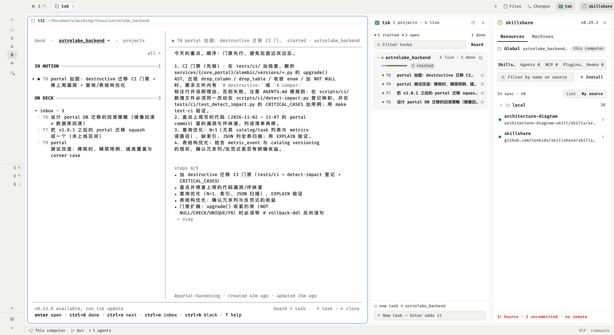

# herdr-work — 一个把 tsk 和 skillshare 并排放在 Herdr 里干的布局

Herdr 的 `main` 布局只给你一个右侧面板栈（Files / Changes）。这个仓库在那条线上加了两样东西：

- **`tsk` 面板**：把 tsk 各个项目里「在等你评审的 / 被卡住的 / 正在跑的」任务摊开在侧栏，当前 space 所在的项目排最前，
  一条 Enter 就能给自己加一条任务，一次点击就能把任务推到 `started` / `done`，或者在该项目的目录里打开 tsk 自己的 board。
- **`skillshare` 面板**：`runkids/skillshare` 的 herdr 面板（skills / agents / MCP / plugins / hooks 的同步状态），
  和 tsk 一样的开关方式，只是放在 tsk 右边。

两个面板都在**布局节点**里，不在每个 space 各自的 `panel` 栈里 —— Herdr 的 tabs 模块会按 space 还原因栈，
面板放那儿换个 space 就没了；布局节点的显示/隐藏是「布局点击」，跨 space、跨重启都保留。



## 安装

```bash
git clone <this repo> herdr-layouts
cd herdr-layouts
./install.sh          # 复制 mods/tsk 和 layouts/herdr-work.json 到 ~/.config/herdr-app，并跑 herdr-app check
```

然后切到它：

```bash
herdr-app do layout.switch '{"name":"herdr-work"}'
```

Herdr 会热加载 mods 和 layouts，所以正在跑的窗口不用重启。手工装的话就是两步：

1. `mods/tsk/` → `~/.config/herdr-app/mods/tsk/`（**复制，不要软链**：热加载只盯着 Herdr 自己的目录）；
2. `layouts/herdr-work.json` → `~/.config/herdr-app/layouts/`，再 `layout.switch {name:"herdr-work"}`。

要撤回：`make uninstall`（删掉那两个节点，回到 `main` 即可）。

## 依赖

| 东西 | 为什么 | 检查 |
|---|---|---|
| Herdr desktop（`herdr-app`） | 0.1.14 的 `main` 上做的 clone，`tabs-row` 那种改法 0.1.12 起都成立 | `herdr-app --version` |
| `tsk` | 面板的唯一数据源 | `tsk list --all --json \| head -c 200` |
| `skillshare` + 它的 herdr mod | 右面板；没有这个 mod 时布局里的 skillshare 开关是空的 | `ls ~/.config/herdr-app/mods/skillshare` |

`tsk setup herdr` 只往**旧版 TUI**（`~/.local/bin/herdr` 那套 plugin，`~/.config/herdr/plugins.json`）里注册 pane，
和 herdr-app 的 layouts/mods 是两套东西 —— 这也是这里要自己写一个 mod 的原因。

## 布局结构

```
root row
├── sidebar (px 268)            brand / spaces + agents / footer —— 与 main 相同
└── work column
    ├── tabs-row (px 42)        tabs(weight 1) │ tsk-toggle(px 74) │ skillshare-toggle(px 108)
    ├── work-body row (padding 8, gap 8)
    │   ├── main               { tab: "active" }，带 pane 头部
    │   ├── panel (px 368, hidden)   files / changes 栈（main 自带的那个）
    │   ├── tsk-panel (px 324, min 260, max 620)
    │   └── skillshare-panel (px 372, min 300, max 720)
    └── status (px 28)
```

两个 toggle 是同一个 mod 的另一个 `props.role`，点它就是 `layout.toggle {id}`：

```json
{ "id": "tsk-toggle", "type": "block", "content": { "mod": "tsk", "props": { "role": "toggle" } }, "size": { "px": 74 } }
```

面板这一列则是：

```json
{ "id": "tsk-panel", "type": "column", "size": { "px": 324 }, "min": 260, "max": 620,
  "children": [ { "id": "tsk", "type": "block", "content": { "mod": "tsk" } } ] }
```

窄屏上把两列都关掉，主区就回到接近 `main` 的样子；宽度拖一下会记住。

## tsk 面板读什么

一次 exec，两条命令，用一个标记分开（`tsk` 的 `--done` 是另一个视图，合起来才是一张完整的表）：

```sh
tsk list --all --json
printf "\n@@tsk-done@@\n"
tsk list --all --done --json
```

- 每 20 秒刷新一次，面板被 `layout.hide` 时跳过（省得白跑）；重新显示时立刻刷一次。
- 行按项目分组：**当前 space 所在目录（含子目录）命中的项目**排最前并展开，其余按「需要你处理的数量」→ 总量 → 名字排。
  没有任何 live 任务的项目不显示（除非你的 space 正开在里面）。
- 每条任务显示 `T编号`、状态色点、标题、线程/指派人；点开一行会看到阻塞原因或 review 检查进度，以及 `Start` / `Done`。
- 顶栏彩色圆点旁边那个数字是 `review + blocked` 的总和，同时写进 `shared("tsk.attention")`，
  所以 tsk 的开关按钮上会带一个角标 —— 面板关着的时候也知道有几条在等你。
- 底部输入框是 `tsk add`：默认落在当前 space 的项目里，没有 space 匹配就落到 desk（`--desk`）。
- 项目行右边的 □ 按钮在这个项目的目录里开一个新 tab 跑 `tsk`，等于 `tab.new {folder, argv:["tsk"]}`。

### 「用 tsk 管 herdr 里多个项目的进度」

能，而且上面这个面板就是这件事的最小实现：两边的**锚点都是目录**。

- Herdr 知道 space → `folder`；tsk 知道 task → `project`（绝对路径）。`matchesFolder(project, folder)` 就是那张对照表，
  连「space 开在仓库子目录里」也算命中。
- 所以侧栏能回答「我正在干的这几个仓库，各自卡在哪」：当前项目展开、其他项目一行一个进度条（done 半透明 + 各状态色段）。
- 反过来，点 □ 就在那个项目的正确目录里打开 tsk 的 board，不需要 `cd`；任务在 board 里改，20 秒内回到面板。
- 写操作只有三个，全部走 tsk 的正式 CLI（`add` / `status`），不做数据库级别的改动：`add -t <标题> [-p <路径>|--desk]`、
  `status T12 started`、`status T12 done`。退出码 0 才提示成功，1/2/3 的错误原文照贴。

已知边界：面板用 `--all` 读全局，所以它看得见**没有**开 space 的项目（会排在后面）；反过来它不会替你切 space。
`tsk list` 的 `--json` 里没有 steps 进度，所以任务行只显示 `steps` 之外的字段。

## 测试

```bash
make test     # node --test tests/  —— model.js 的数据层，不需要 Herdr
make check    # 再跑一遍 herdr-app check mods/tsk（QuickJS 的规矩 node 看不出来）
```

`model.js` 不 import `herdr`，解析、分组、排序、参数拼装都在里面，所以能直接跑测试。`main.js` 只管视图。

## 文件

```
layouts/herdr-work.json   布局本体（clone 自 main 0.1.14）
layouts/herdr-work.png    它的截图
preview.png               两个面板都开着的截图
mods/tsk/main.js          tsk 面板 + 顶栏开关（唯一 import herdr 的文件）
mods/tsk/model.js         tsk 输出 → 行 / 项目 / 进度；add、status 的参数
mods/tsk/mark.svg         图标；icons/ 是 16 个描边图标
tests/model.test.mjs      13 组断言
install.sh / Makefile     装、检查、截图、把布局从 Herdr 拉回仓库
RECIPE.md                 这个布局为什么长这样（改之前先读）
```
