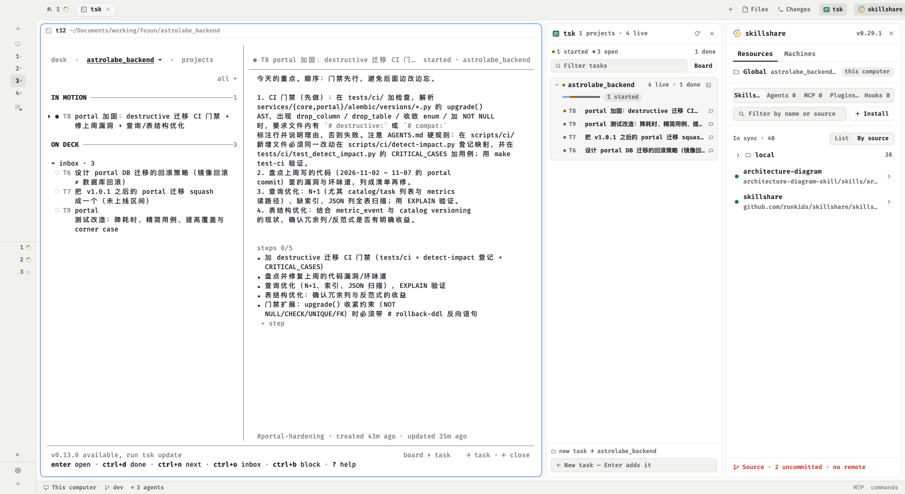

# herdr-work

Herdr's `main` layout with two columns added beside the terminal: tsk's task progress across every
tsk project (what waits on your review, what is blocked, what is moving) and skillshare's sync status.
Both columns are switched from the tab bar, so a narrow window can drop them without losing them.



## What you see

Left to right, the window is still `main`'s:

- **Sidebar** (`px 268`, `min 44`, `max 480`, not resizable): brand, `spaces`, `agents`, footer — untouched
  from `main`. Narrowed under 160px it becomes the numbered rail that `main` ships.
- **Work column** (not resizable), three rows: the tab bar, the body, the status bar.
- **Tab bar row** (`px 42`, not resizable, `padding [0, 8]`): the tabs strip (`weight 1`, keeps
  `window_drag`) then two fixed buttons — `tsk-toggle` (`px 74`) and `skillshare-toggle` (`px 108`).
  Each is the same mod as its panel with `"props": {"role": "toggle"}`: a 26px-high rounded button with
  the mod's mark, the name at 12px, and a count pill when something needs you. The 8px right padding is
  what keeps the last button off the window edge.
- **Body row** (`row`, `padding 8`, `gap 8`): the active tab's terminals, `main`'s hidden
  files/changes `panel` (`px 368`, `min 280`, `max 900`, `hidden`), `tsk-panel` (`px 330`, `min 260`,
  `max 620`), `skillshare-panel` (`px 340`, `min 300`, `max 720`).
- **Status bar** (`px 28`), unchanged.

The tsk column is a card: white surface, 10px radius, 1px border, one column of:

- header: `tsk` mark, the word `tsk`, the subtitle `3 projects · 7 live`, a refresh icon and a close icon;
- a strip of at most three chips — `review`, `blocked`, `started` — each a 6px dot plus `1 review`, with
  review and blocked in their status colour and started in muted; `nothing needs you` when empty; the count
  of finished tasks (`1 done`) pinned right;
- a filter input (`Filter tasks`) and a `Board` button;
- one card per project: name, `4 live · 1 done`, a progress bar (one colour segment per status, done
  at half opacity), the attention pills (`1 review`, `1 blocked`), and the tasks — `T3` in the status
  colour, the title, then thread/assignee chips when set; clicking a task unfolds `why blocked`,
  `review: 2/3 checks`, `dispatch …`, the last activity line and `Start` / `Done`;
- a capture input at the bottom: `new task → aurora-api`, placeholder `New task — Enter adds it`.

Colours are Herdr theme tokens only: `review` = `accent`, `blocked` = `blocked`, `started` = `working`,
`ready` = `done`, `open` = `muted`, `done` = `dim`. Type sizes derive from `settings().ui_font_size`
(title +1, body +0.5, secondary −0.5, label −1).

## How it behaves

- On mount, and every 20s, the panel runs one `exec`: `tsk list --all --json`, a `@@tsk-done@@` marker,
  then `tsk list --all --done --json`. Refreshes are skipped while the panel node is hidden and run
  immediately when it is shown again.
- Grouping: projects hold tasks; a project is "the current one" when any open space's folder
  (or the focused terminal's cwd) is that path or inside it. The current project sorts first and unfolds
  by itself on the first load; everything else follows sorted by how much needs you, then total, then name.
  Projects with no live task are dropped unless an open space sits in them; tasks in the done view mark
  `1 done` and never show as rows.
- The tab-bar button toggles the layout node: `layout.toggle {id: "tsk-panel"}` /
  `layout.toggle {id: "skillshare-panel"}`. Its pill reads `shared("tsk.attention")` — review plus blocked
  across all projects — so the count is visible with the panel closed.
- Clicks: toggle button → hide/show the column; close icon → `layout.hide`; refresh icon → refetch now;
  `Board` → `tab.new` running `tsk` in that project's folder (its own cwd when the project is the desk);
  a project header → fold/unfold; `Start` → `tsk status T<n> started`, then `tab.new {name: "T<n>", folder: the
  task's project, argv: agent.run, task: the brief}` so a coding agent picks the task up in a new tab (its first
  message is the brief: title, thread, project path, `tsk list --all --json`, and `tsk status T<n> review` at the
  end); `Done` → `tsk status T<n> done`;
  both refetch on success and print the command's own error text on failure.
- Typing: the filter narrows projects and tasks as you type; the capture input adds a task on Enter
  (`tsk add -t <title>`, plus `-p <path>` or `--desk`), and Escape clears the filter. The panel has no
  keys of its own and ships no `keys.json`; everything else is Herdr's.
- Nothing moves on its own except the progress bars (they follow `tsk`'s data) and the pill count.

## Built from

Node tree in `layouts/herdr-work.json`, a `layout.clone` of `main` 0.1.14 (`cloned_from` records it):

```
root (row, titlebar none, traffic_lights [12,16])   ← from main
├── sidebar (column px 268)                          ← from main
└── work (column, resizable false)                   ← from main
    ├── tabs-row (row px 42, resizable false, padding [0,8])   ← new wrapper
    │   ├── tabs          (block weight 1, window_drag, mod "tabs")
    │   ├── tsk-toggle    (block px 74,  mod "tsk",       props {role:"toggle"})
    │   └── skillshare-toggle (block px 108, mod "skillshare", props {role:"toggle"})
    ├── work-body (row, padding 8, gap 8)            ← from main, children added
    │   ├── main        (block, the active tab's terminals)
    │   ├── panel       (column px 368, hidden)      ← from main, files/changes
    │   ├── tsk-panel   (column px 330, min 260, max 620) [block mod "tsk"]
    │   └── skillshare-panel (column px 340, min 300, max 720) [block mod "skillshare"]
    └── status (px 28)                               ← from main
```

`mods/tsk/` — one mod, two roles via `props.role`: `panel` (a `View`) and `toggle`.

- `main.js` imports `herdr` and draws both. `herdr` calls: `exec`, `run`, `spaces`, `focused`, `home`,
  `knownAgents`, `shared`, `setShared`, `theme`, `settings`, `layout`, `props`. Drawing uses `gpui-kit`
  (`View`, `div`, `image`, `svg`) and `gpui-base` (`v_flex`, `h_flex`, `InputState`, `Input`).
  Commands it runs: `layout.toggle`, `layout.hide`, `tab.new`.
- `model.js` has no Herdr imports: `LIST` (the two-command shell script), `PATHS` (prepends
  `~/.local/bin`, `~/go/bin`, `/opt/homebrew/bin`, `/usr/local/bin`), `parseList` (splits on the marker,
  parses both arrays), `buildProjects`, `totalsOf`, `filterTasks`, `filterProjects`, `idOf`,
  `addArgs`, `statusArgs`, `boardOf`, `taskHint`, and for Start: `agentBrief`, `pickAgent`, `launchArgs`.
- Which agent Start runs: `props.run` if the panel block carries one (an argv, e.g. `["pi"]`), else
  `knownAgents()` (Herdr's list of agents with a `run`, most picked first) filtered to what is installed,
  matched by `props.agent` (key or name) or else the first; `props.agent: "none"` makes Start status-only.
- Programs it runs: `tsk list --all --json`, `tsk list --all --done --json`, `tsk add -t <title>
  [-p <path>|--desk]`, `tsk status T<n> started|done`, `tab.new {folder, argv:["tsk"]}`. Never the
  database; a non-zero exit prints the command's last stderr line.
- Art: `mark.svg` (the tsk check mark) and 16 stroke icons in `icons/` (`refresh`, `close`, `search`,
  `chevron-*`, `folder`, `desk`, `thread`, `bot`, `alert`, `check`, `plus`, `terminal`). No images, no
  network calls beyond `exec`.
- The skillshare column is someone else's mod, unmodified: `runkids/skillshare`'s `herdr/skillshare`.

## Watch out

- **Do not put these panels in `main`'s `panel` stack.** The `tabs` mod rebuilds that stack per space, so a
  column added there disappears on a space switch. A layout node's own `hidden` is a layout click: it
  survives space switches and restarts.
- Give the *wrapping column* the `size` / `min` / `max`, never the inner block — the column is what drags,
  the block just fills it. `padding` on a `row` pads both sides (`[vertical, horizontal]`), which is how
  the tab bar gets its 8px right margin without shifting the tabs strip.
- Width budget at 1920: `main` will not go much under ~1150px, so `268 (full sidebar) + 1150 + 330 + 340`
  overflows and the last column is pushed off-screen. It fits with the sidebar rail (76px) or with narrower
  columns; below 1440 hide one column. Trying to shrink `main` instead does nothing.
- **QuickJS**: `??` may not mix with `||` or `&&` without parentheses — `node --check` accepts it,
  `herdr-app check` does not. Run `make check`.
- No `setShared` or `cx.notify()` during render; state changes go through `later(cx, …)` or a spawn.
  `.child(null)` throws — use `.children([…].filter(Boolean))` or `.when()`.
- Element ids carry project paths and task ids, so they go through `idOf()`; the same id twice in one tree
  is a bug.
- Editing a mod in place does not always reload it in a running window; a fresh folder name (or a restart)
  does. Install by copying — a symlinked mod is not picked up.
- A mod reaches `exec`, so this layout runs `tsk` from your `PATH`; `tsk` missing shows the install hint in
  the panel instead of an empty card. Start runs the agent from `agent.run`, so an agent Herdr cannot find
  installed only marks the task started and says so in the notice — nothing is launched silently.
- A tsk title is the agent's first message: keep titles self-contained, since the brief adds only the thread,
  the project path and the hand-back line.
- `tsk list --json` carries no steps progress, so rows show thread, assignee, block reason and review
  checks but no step count. `--all` reads the global store: tasks of projects with no open space still
  appear, just further down.

## Done when

- `herdr-app check mods/tsk` prints `check passed: mods/tsk` and `node --test tests/` passes (19 tests).
- `herdr-app do layout.switch '{"name":"herdr-work"}'` shows three columns: terminal, tsk, skillshare, with
  the two buttons at the right end of the tab bar and 8px of space after the last one.
- The panel lists the project your active space sits in first, unfolded, with the rest below; the header
  subtitle counts projects and live tasks; the strip shows review/blocked/started chips that fit inside the
  column.
- `layout.hide {id:"tsk-panel"}` hides the column, the tab-bar button no longer looks selected, and its pill
  still shows the review + blocked count; `layout.toggle` brings the column back with fresh data at once.
- `Start` on a row makes the task `started` in `tsk list --all --json` and in tsk's own board within the
  next refresh, and opens a tab in the task's project running a coding agent whose first message is the
  brief (title, thread, project folder, `tsk status T<n> review`); `Done` sets it `done`. A capture like
  `Write the changelog` appears as a new task in the current space's project.
